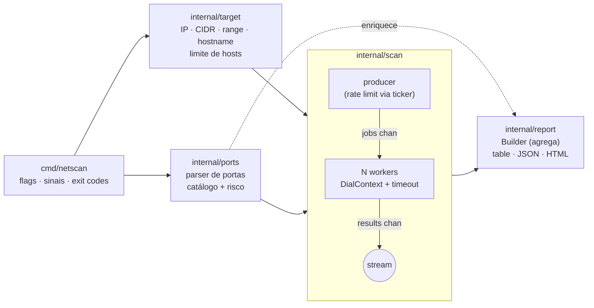

# netscan

```
$ netscan -p critical 192.168.0.0/24
[*] scanner TCP concorrente · CIDR/ranges · portas críticas · relatório HTML/JSON
```

Scanner de portas TCP (*TCP connect scan*) escrito em Go, focado em **inventário e triagem de exposição** em redes internas: expande alvos (IP, CIDR, ranges, hostnames), testa portas de forma concorrente e controlada, identifica serviços sensíveis (RDP, SMB, Telnet, bancos de dados...) e gera relatório em tabela, JSON ou HTML.

Somente biblioteca padrão do Go: sem dependências externas.

> [!WARNING]
> **Aviso legal e ético.** Use esta ferramenta **apenas em redes e hosts que você administra ou para os quais tem autorização formal e por escrito**. Varredura de portas sem autorização pode violar a Lei 12.737/2012 (Lei Carolina Dieckmann), políticas internas e termos de provedores, além de disparar alertas de IDS/SOC. O autor não se responsabiliza pelo uso indevido.

---

## Funcionalidades

- **Alvos flexíveis**: `10.0.0.5`, `10.0.0.0/24`, `10.0.0.10-50`, `10.0.0.1-10.0.1.254`, `servidor.empresa.local`, IPv6 (endereço ou CIDR).
- **Proteção contra ranges gigantes**: o tamanho do range é calculado *antes* da expansão; acima de `-max-hosts` (padrão 65.536, um /16) o scan é recusado.
- **Portas**: `22,80,443`, `1-1024`, `top100`, `critical`, `all`, ou combinações (`top100,8443,9000-9010`).
- **Concorrência limitada**: pool fixo de workers (`-c`), timeout por conexão (`-timeout`) e limite opcional de conexões por segundo (`-rate`).
- **Estados de porta**: `open` (handshake completo), `closed` (RST, prova que o host está ativo) e `filtered` (sem resposta / inalcançável).
- **Banner grabbing passivo** (`-banner`): lê o que o serviço envia primeiro (SSH, FTP, SMTP...). O texto é sanitizado (caracteres de controle e sequências ANSI removidos).
- **Catálogo de portas críticas** com nome do serviço, nível de risco (`info`, `medium`, `high`, `critical`) e nota de remediação.
- **DNS reverso** opcional (`-rdns`) para hosts com portas abertas.
- **Saídas**: tabela no terminal, JSON (para pipelines/SIEM) e HTML autocontido (escapado via `html/template` + CSP restritiva).
- **Ctrl+C gracioso**: interrompe o scan, cancela conexões em andamento e ainda grava o relatório parcial (exit code 130).

## Uso

```
netscan [flags] <alvo> [alvo...]
```

> As flags vêm **antes** dos alvos (comportamento do pacote `flag` da stdlib).

| Flag | Padrão | Descrição |
|---|---|---|
| `-p` | `top100` | Portas: `22,80,443`, `1-1024`, `top100`, `critical`, `all` |
| `-c` | `100` | Máximo de conexões simultâneas |
| `-timeout` | `1s` | Timeout por conexão |
| `-rate` | `0` | Máximo de novas conexões por segundo (0 = sem limite) |
| `-banner` | `false` | Captura banner das portas abertas |
| `-rdns` | `false` | DNS reverso dos hosts com portas abertas |
| `-o` | `table` | Formato: `table`, `json`, `html` |
| `-out` | stdout | Arquivo de saída |
| `-max-hosts` | `65536` | Limite de hosts por execução |
| `-q` | `false` | Sem mensagens de progresso no stderr |
| `-version` | | Mostra a versão |

### Exemplos

```bash
# Portas críticas em uma sub-rede, com banners
netscan -p critical -banner 192.168.0.0/24

# Top 100 portas, mais lento e "educado" (50 conexões/s), relatório HTML
netscan -rate 50 -o html -out relatorio.html 10.10.0.1-10.10.0.254

# Range completo de portas em um host, saída JSON para outra ferramenta
netscan -p all -c 500 -timeout 500ms -o json srv-app01.empresa.local | jq '.hosts[].ports[].port'
```

### Saída real (laboratório em `127.0.0.1`)

Execução contra listeners locais criados só para a demonstração (portas 2121, 2222, 6379 e 8080):

```
$ netscan -p 21,22,80,443,2121,2222,6379,8080 -banner -timeout 500ms 127.0.0.1
[*] scanning 1 host(s) x 8 port(s) = 8 probes (concurrency 100, timeout 500ms)
[+] 127.0.0.1:2121 open
[+] 127.0.0.1:2222 open
[+] 127.0.0.1:6379 open
[+] 127.0.0.1:8080 open
HOST       PORT      SERVICE   RISK      LATENCY  BANNER
127.0.0.1  2121/tcp  -         info      2.1ms    220 (vsFTPd 3.0.5)
127.0.0.1  2222/tcp  -         info      2.1ms    SSH-2.0-OpenSSH_9.6 lab
127.0.0.1  6379/tcp  redis     critical  2.1ms    -
127.0.0.1  8080/tcp  http-alt  info      2.1ms    -

1 host(s) scanned, 1 up, 1 with open ports | probes: 4 open, 4 closed, 0 filtered | high/critical: 1 | 1.00s
```

Repare que 2121 e 2222 aparecem como `-`: a identificação de serviço é feita **pelo número da porta** (catálogo), não por fingerprint. O banner é o que revela que ali há FTP e SSH. As mensagens `[*]`/`[+]` vão para o **stderr**; o relatório vai para o **stdout** (ou `-out`), então `netscan ... > out.txt` captura só o relatório.

### Exit codes

| Código | Significado |
|---|---|
| `0` | Scan concluído |
| `1` | Erro de execução (ex.: falha ao gravar o arquivo) |
| `2` | Uso inválido (flag, porta, alvo, range acima do limite) |
| `130` | Interrompido por Ctrl+C / SIGTERM (relatório parcial gravado) |

## Arquitetura



```
cmd/netscan/         CLI: parsing de flags, Ctrl+C (signal.NotifyContext), orquestração
internal/target/     Parsing e expansão de alvos com net/netip, deduplicação, limite de hosts
internal/ports/      Parser de especificação de portas, top100, catálogo de serviços críticos
internal/scan/       Scanner TCP connect: worker pool, contexto, timeout, rate limit, banner
internal/report/     Agregação dos resultados e renderização (tabwriter, encoding/json, html/template)
```

### Decisões de projeto

- **TCP connect em vez de SYN scan**: usa a API normal de sockets, então não exige root/administrador nem raw sockets e funciona igual em Linux, Windows e macOS. O custo é ser mais "barulhento" (handshake completo, aparece em logs) e um pouco mais lento que um SYN scan.
- **Pool fixo de workers** em vez de uma goroutine por porta: a concorrência é limitada de verdade (`-c`), evitando esgotar descritores de arquivo ou portas efêmeras em scans grandes.
- **Pipeline com canais**: um *producer* gera os pares (host, porta), os workers consomem e os resultados são *streamados*. O relatório guarda apenas as portas abertas e só **conta** fechadas/filtradas, então a memória não cresce com `hosts × portas`.
- **Cancelamento por `context`**: Ctrl+C cancela o contexto raiz; o producer para de agendar, os `DialContext` em andamento são abortados e resultados interrompidos são descartados (o estado deles é desconhecido, então não são reportados como `filtered`).
- **`closed` vs `filtered`**: conexão recusada (RST) significa host ativo e porta fechada; timeout significa sem resposta (firewall descartando ou host inexistente). No Windows o erro de recusa é o `WSAECONNREFUSED` do Winsock, tratado em um arquivo com build tag (`refused_windows.go`).
- **`net/netip`** em vez de `net.IP`: tipo de valor, comparável (serve como chave de map para deduplicação) e com `Next()`/`Prev()` para iterar ranges.
- **Limite calculado antes de expandir**: `10.0.0.0/8` é rejeitado na hora, sem alocar 16 milhões de endereços.
- **HTML seguro**: banners e hostnames vêm da rede e são tratados como entrada hostil. `html/template` faz escape contextual, e o relatório inclui uma CSP (`default-src 'none'`) que bloqueia scripts mesmo se algo escapar. Há teste específico para isso.
- **Somente stdlib**: `flag` é suficiente para essa CLI; cobra não se justificaria aqui.

### Limitações (conhecidas e intencionais)

- Apenas TCP; não há scan UDP nem descoberta por ICMP/ARP. Um host que filtra todas as portas testadas aparece como inativo.
- Identificação de serviço por número de porta; não há fingerprinting de versão.
- O banner é passivo: serviços que esperam o cliente falar primeiro (HTTP, por exemplo) retornam banner vazio.
- Ranges no formato `a-b` só para IPv4; para IPv6 use CIDR (sujeito ao `-max-hosts`).
- O nível de risco do catálogo é uma heurística de triagem, não um achado de vulnerabilidade.

## Build e testes

Requer Go 1.25+ (o `go.mod` declara `go 1.25` porque o código usa `sync.WaitGroup.Go`).

```bash
# Build
go build -o bin/netscan ./cmd/netscan
# ou, com versão embutida:
make build VERSION=v0.1.0

# Testes
go vet ./...
go test ./...
go test -race ./...        # requer cgo (um compilador C instalado)

# Atualizar os arquivos golden do relatório após mudança intencional de saída
go test ./internal/report -update
```

Os testes cobrem:

- **target / ports**: testes table-driven de parsing (CIDR, /31, /32, ranges, shorthand, IPv6, hostnames com resolver falso, duplicatas, limites, entradas inválidas).
- **scan**: listeners reais em `127.0.0.1` (porta aberta, fechada, banner, serviço silencioso), timeout e cancelamento via dialer injetado, limite de concorrência, rate limit e sanitização de banner.
- **report**: arquivos *golden* para tabela/JSON/HTML, round-trip do JSON e teste de escape de XSS no HTML.
- **cmd/netscan**: teste ponta a ponta da CLI contra um listener local, erros de uso e execução interrompida.

### Lint

Configuração em [`.golangci.yml`](.golangci.yml) (golangci-lint v2):

```bash
golangci-lint run
```

### Docker

```bash
docker build -t netscan --build-arg VERSION=v0.1.0 .
docker run --rm netscan -p critical 192.168.0.0/24
# No Linux, use --network host para escanear a rede do host em vez da rede do container
```

Imagem multi-stage: compila estático (`CGO_ENABLED=0`) e roda em `distroless/static` como usuário não-root.

### CI

[`.github/workflows/ci.yml`](.github/workflows/ci.yml): `gofmt`, `go vet` e `go test -race` em Linux, Windows e macOS; golangci-lint; e cross-compile (linux/windows/darwin, amd64/arm64) com os binários e seus SHA-256 publicados como artefatos do workflow.

## Licença

[MIT](LICENSE) © 2026 Lucas Santos
